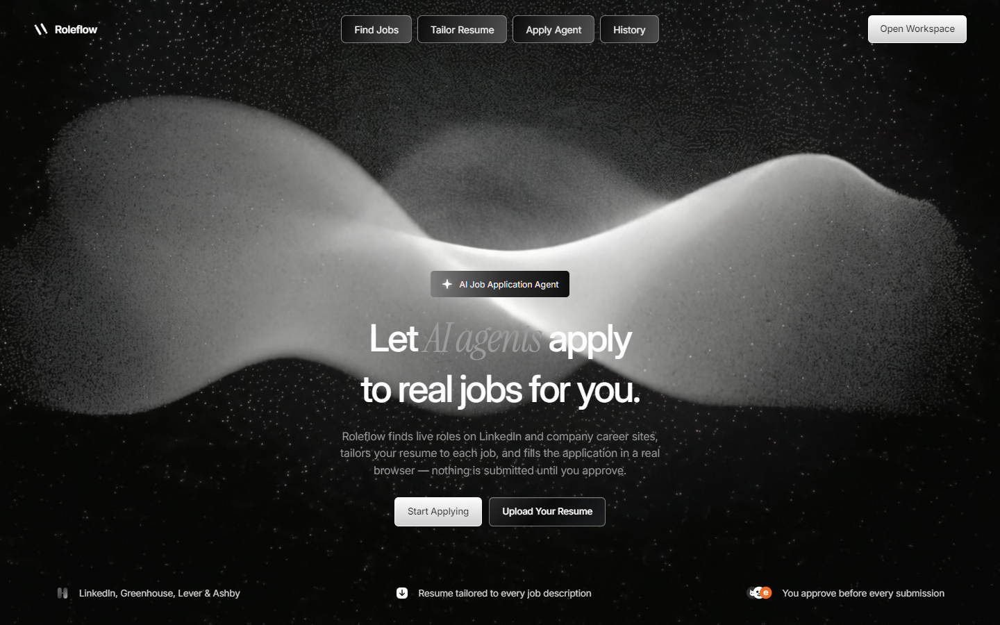
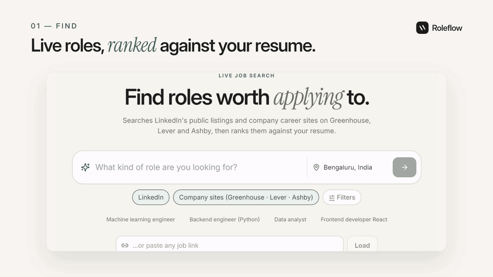
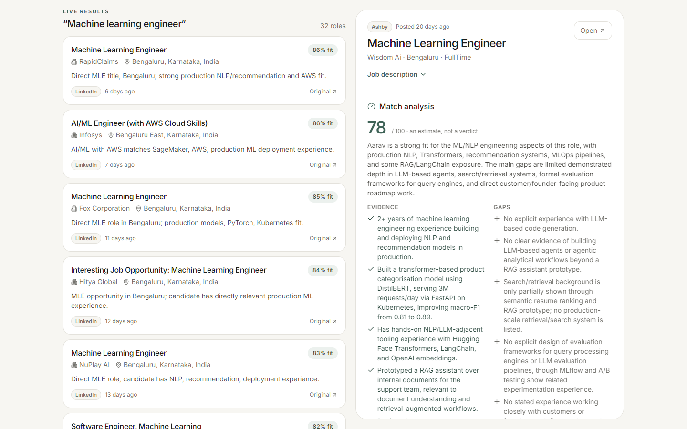
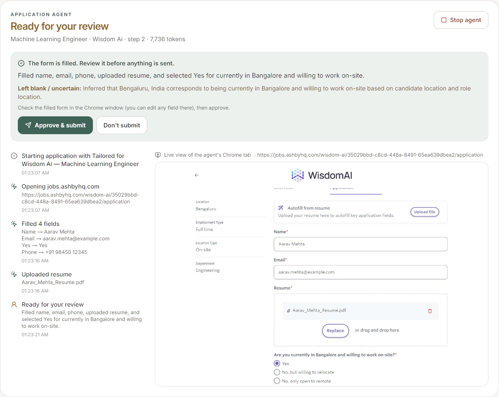
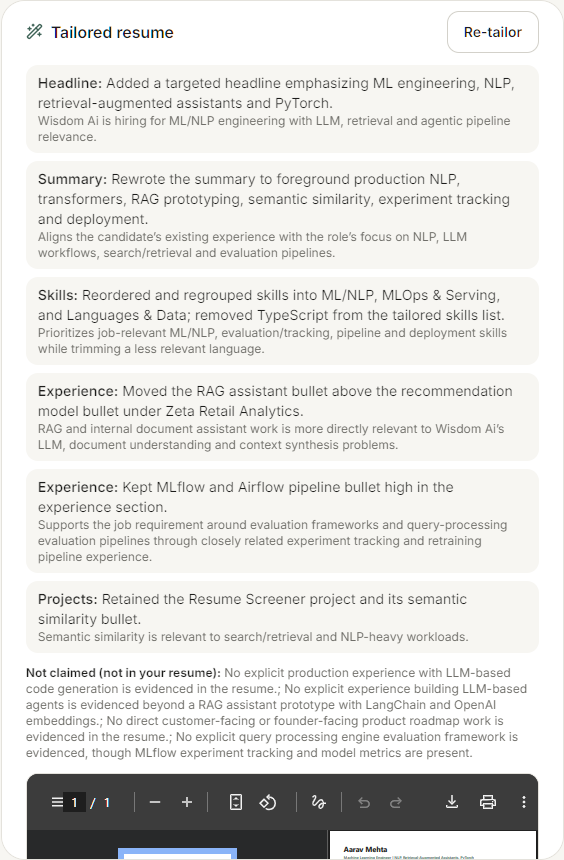
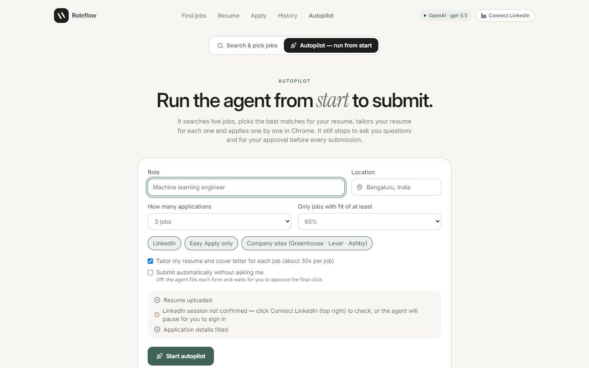
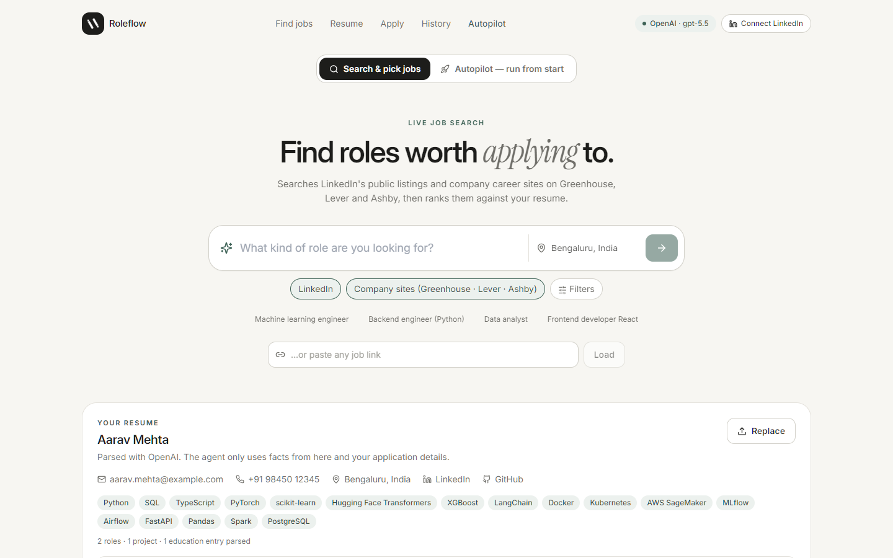
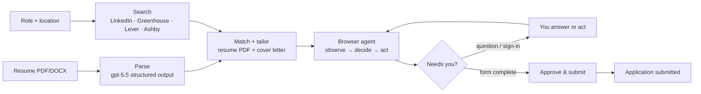

<div align="center">



# Roleflow

**An open-source AI agent that finds real jobs, tailors your resume to each one, and fills in the actual application in your browser. Nothing is submitted until you approve.**

[](https://github.com/Deveshu04/roleflow/actions/workflows/ci.yml)
[](https://github.com/Deveshu04/roleflow/actions/workflows/codeql.yml)
[](LICENSE)


[Demo](#demo) · [Features](#features) · [Quick start](#quick-start) · [Architecture](docs/ARCHITECTURE.md) · [Contributing](CONTRIBUTING.md)

</div>

## Demo

<a href="docs/media/roleflow-demo.mp4"></a>

<p align="center"><a href="docs/media/roleflow-demo.mp4"><b>▶ Watch the full demo (75 s, MP4)</b></a> · made with <a href="video/">Remotion</a></p>

<sub>Real UI and a real agent run on a live Greenhouse posting with a fictional candidate. The run was stopped at the approval step, so nothing was submitted.</sub>

## Why

Applying for jobs is the same loop over and over: find a role, tweak your resume, retype the same answers into another form, upload, repeat. Roleflow automates the loop but keeps you in charge:

- It works on **live listings and the employers' real application forms**, not a sandbox.
- It **never invents** experience, dates, salary or work authorization. When it doesn't know something, it asks you.
- It **stops before the final Submit** and shows you exactly what it filled.

## Features

| | |
|---|---|
| 🔎 **Live job search** | LinkedIn's public listings plus company career sites on **Greenhouse, Lever and Ashby** (found with OpenAI web search and verified through each ATS's public API). Results are ranked against your resume. You can also paste any job link. |
| 📄 **Resume understanding** | Upload a PDF or DOCX. The text and hidden hyperlinks are parsed into a structured profile. |
| 🎯 **Match analysis** | A score with concrete evidence from your resume, the gaps, and the things worth confirming before you apply. |
| ✍️ **Per-job tailoring** | A rewritten resume PDF and cover letter for each job. Every edit is listed with a reason. Employers, titles, dates and education are restored in code, and skills you never listed are dropped. |
| 🤖 **Browser agent** | Opens the real application in Chrome and fills it in: text fields, dropdowns, type-aheads, checkboxes and resume uploads. Multi-step and LinkedIn Easy Apply flows are supported. A live view and timeline show every action. |
| 🙋 **Human in the loop** | Asks for missing facts (and remembers your answers), pauses for sign-ins and CAPTCHAs, and waits for **Approve & submit**. |
| 🚀 **Autopilot** | Give it a role, a location and a number of applications. It searches, picks the best matches, tailors your resume for each and applies one by one, still stopping for your approval. |
| 🛡️ **Guardrails in code** | Submit gate, browser-validation check, demographic "decline" enforcement, URL allow-list, retry and token caps. |

## Screenshots

<table>
  <tr>
    <td width="50%"><br/><sub><b>Live search + match analysis.</b> Real listings ranked by fit, with evidence and gaps.</sub></td>
    <td width="50%"><br/><sub><b>Browser agent.</b> It filled a real Ashby form, uploaded the tailored resume and is waiting for approval.</sub></td>
  </tr>
  <tr>
    <td><br/><sub><b>Tailored resume.</b> Each change explained; anything not on your resume is listed as not claimed.</sub></td>
    <td><br/><sub><b>Autopilot.</b> Runs from search to submit for several jobs, with a readiness checklist.</sub></td>
  </tr>
  <tr>
    <td colspan="2"><br/><sub><b>Workspace.</b> Natural-language search, sources, and the parsed resume profile.</sub></td>
  </tr>
</table>

<sub>Screenshots use a fictional candidate.</sub>

## How it works



Each agent step sends the model a numbered map of the page's interactive elements (across iframes, shadow DOM and modals), a low-detail screenshot, your facts and a compact action history. The model replies with tool calls (`fill_fields`, `upload_file`, `click`, `ask_user`, `ready_to_submit`…), which a Playwright executor carries out and verifies.

The full design, with data flows, state machine, guardrails, data model and API, is in **[docs/ARCHITECTURE.md](docs/ARCHITECTURE.md)**.

## Quick start

Requirements: **Node.js 20.9+**, **Google Chrome** (or Edge, via `BROWSER_CHANNEL=msedge`), and an **OpenAI API key**.

```bash
git clone https://github.com/Deveshu04/roleflow.git
cd roleflow
npm install
cp .env.example .env.local      # then set OPENAI_API_KEY
npm run dev
```

Open **http://127.0.0.1:3000**. The landing page is at `/` and the workspace at `/app`.

1. **Upload your resume**, then open **Application details** and fill in your location, work authorization, notice period and salary expectations, so the agent rarely has to stop and ask.
2. *(Optional)* Click **Connect LinkedIn** and sign in yourself in the Chrome window that opens. The session stays in the agent's own browser profile, and the app never sees your password.
3. **Search** for a role or paste a job link, then **Analyze**, **Tailor for this job** and **Run application agent**. Or switch to **Autopilot** to do several jobs in a row.
4. Answer any question in the agent panel, check the filled form in Chrome, and click **Approve & submit**. **Don't submit** stops the run and leaves the tab open.

## Configuration

All settings are environment variables in `.env.local`:

| Variable | Default | Description |
|---|---|---|
| `OPENAI_API_KEY` | — | **Required.** Used for parsing, matching, tailoring, web search and the agent. |
| `OPENAI_MODEL` | `gpt-5.5` | Model for parsing, matching, tailoring and search. |
| `OPENAI_AGENT_MODEL` | `OPENAI_MODEL` | Model that drives the browser agent. |
| `BROWSER_CHANNEL` | `chrome` | `chrome`, `msedge` or `chromium`. |
| `HEADLESS` | `false` | Hide the agent's browser. You then can't sign in or solve CAPTCHAs. |
| `AGENT_MAX_STEPS` | `40` | Model steps per application. |
| `AGENT_MAX_RUN_TOKENS` | `150000` | Input-token budget per application; the run stops and leaves the tab open. |
| `ROLEFLOW_DATA_DIR` | `./data` | Where resumes, runs and the agent's browser profile are stored. |

**Cost:** each agent step is about 3–6k input tokens. On live Greenhouse, Lever and Ashby forms a full application took 8–13k input tokens. Every run shows its token usage.

## Privacy and responsible use

- **Local-first.** Everything stays in `data/` on your machine, which is git-ignored. The server binds to `127.0.0.1` only, and the API rejects cross-site and non-localhost requests. Resume text and job pages are sent to OpenAI for processing.
- **Your credentials stay yours.** Roleflow never asks for passwords, never creates accounts and never bypasses CAPTCHAs or bot checks.
- **You are the applicant.** Review every form before approving. Auto-submit is off by default.
- **LinkedIn:** automating actions on your LinkedIn account may break LinkedIn's User Agreement and could lead to restrictions. Keep the volume low and apply only to roles you'd apply to by hand.

## Development

```bash
npm run dev          # http://127.0.0.1:3000
npm run check        # lint + typecheck + tests
npm run build        # production build
npm test             # agent form-engine tests (no API key needed)
```

The tests run the agent's page reader and form filler against fixture forms modelled on Greenhouse, Lever and Ashby, including Lever's location type-ahead, hidden checkboxes, comboboxes, validation and the demographic guard.

CI runs on every push and pull request:

- lint, typecheck and tests on Node 22 and 24
- a production build
- gitleaks secret scanning and `npm audit`
- dependency review
- CodeQL

```
app/            workspace UI and API route handlers
lib/jobs        job sources, import, ranking, match analysis
lib/resume      parsing, tailoring, PDF rendering
lib/agent       browser agent: page snapshot, actions, runner, autopilot
public/landing  landing page
tests/          form-engine tests
video/          Remotion source of the demo video
docs/           architecture, screenshots, media
```

## Contributing

Contributions are welcome. Please read [CONTRIBUTING.md](CONTRIBUTING.md) and the [Code of Conduct](CODE_OF_CONDUCT.md), and report security issues privately as described in [SECURITY.md](SECURITY.md).

## License

[MIT](LICENSE) © 2026 Deveshu Pathak

<sub>Built with Next.js, the OpenAI API, Playwright and Remotion. Roleflow is not affiliated with LinkedIn, Greenhouse, Lever or Ashby.</sub>
