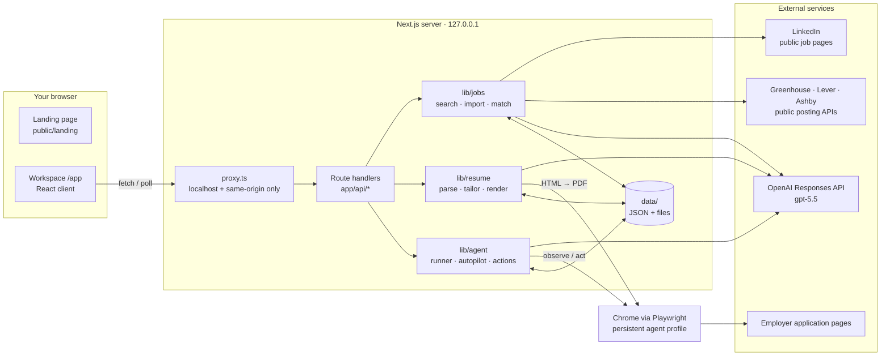
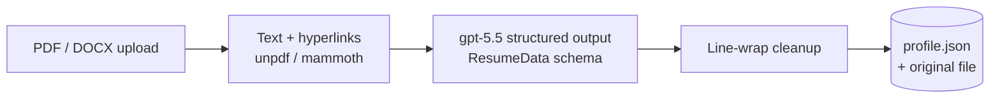
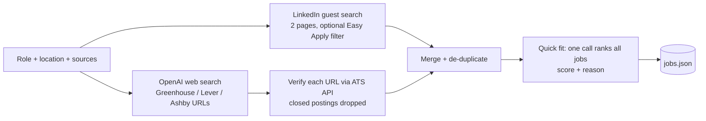
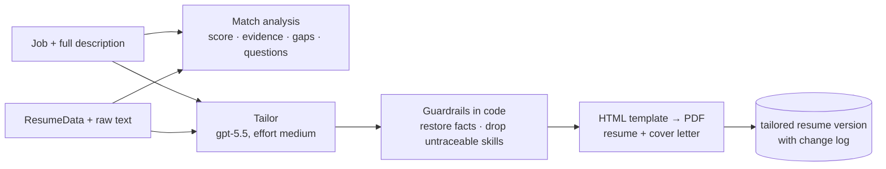
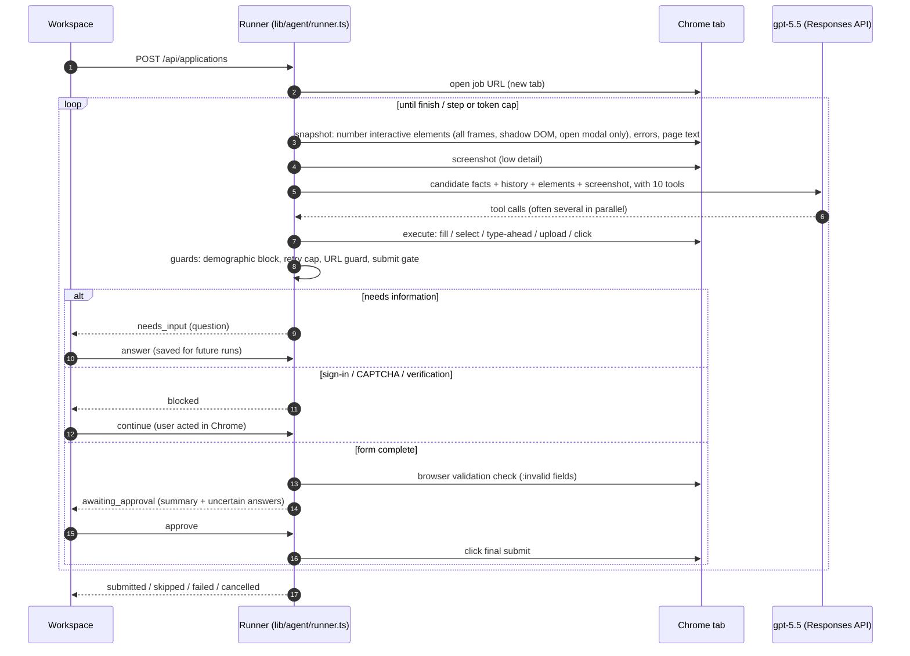
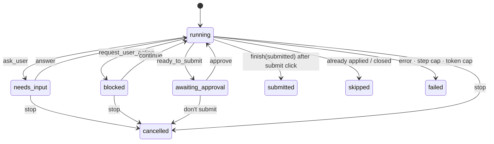

# Architecture

Roleflow is a single Next.js 16 application that runs locally. The React workspace talks to thin route handlers. Those delegate to four server modules in `lib/`, which call OpenAI, public job APIs and a Playwright-controlled Chrome. All state is stored as JSON files and documents on your machine.

- [High-level design](#high-level-design)
- [Components](#components)
- [Input → output flows](#input--output-flows)
- [The browser agent](#the-browser-agent)
- [Autopilot](#autopilot)
- [Guardrails](#guardrails)
- [Data model and storage](#data-model-and-storage)
- [API surface](#api-surface)
- [Configuration](#configuration)
- [Design decisions](#design-decisions)

## High-level design



| Layer | Responsibility |
|---|---|
| **Landing page** (`public/landing/index.html`) | Static marketing page served at `/` via a rewrite. |
| **Workspace** (`app/app/`) | Client UI with search, resume, job panel, Autopilot, live agent panel and history. It polls the API while a run is active. |
| **Route handlers** (`app/api/`) | Validate input and call one service. Errors are converted to user-safe JSON by `lib/api.ts`. |
| **Services** (`lib/`) | All the logic: job sourcing, resume pipeline, browser agent, persistence. |
| **Chrome** | One persistent, visible profile for the agent (your sign-ins stay there), plus a headless instance used only to render PDFs. |
| **OpenAI** | Structured outputs (zod schemas), web search, and function calling with screenshots for the agent. |

## Components

```
app/
  app/                    workspace UI (page + _components)
  api/                    route handlers (see API surface)
lib/
  ai.ts                   OpenAI client, structured() and webSearch() helpers, user-safe errors
  config.ts               environment-driven settings
  store.ts                JSON persistence with per-file write queues
  url-safety.ts           public-address guard for fetches and navigation
  request-guard.ts        localhost / same-origin check used by proxy.ts
  jobs/                   linkedin.ts · ats.ts · web.ts · search.ts · match.ts · details.ts · http.ts
  resume/                 parse.ts · tailor.ts · render.ts · service.ts · schema.ts · text.ts
  agent/                  browser.ts · snapshot.ts · actions.ts · prompts.ts · runner.ts · autopilot.ts
public/landing/           landing page and self-hosted fonts
tests/                    Playwright tests for the agent's form engine
video/                    Remotion source of the demo video
```

## Input → output flows

### 1. Resume ingestion



- **Input:** a resume file of up to 8 MB.
- **Output:** a `ResumeData` record (contact details, summary, skills, experience, projects, education and so on) and an `original` resume version.
- Hyperlink annotations are extracted, so LinkedIn and GitHub URLs hidden behind link text are kept.

### 2. Job discovery



- **Input:** a free-text role, a location, and the sources to search.
- **Output:** up to about 30 `Job` records, ranked by `quickFit`.
- **Pasting a link instead:** the app tries the ATS public API first, then schema.org `JobPosting` JSON-LD, then LLM extraction from the page text.

### 3. Match and tailoring



- **Input:** the job description and the parsed resume.
- **Output:** a tailored resume PDF, a cover-letter PDF, a list of `{section, change, reason}` entries, and the job requirements the resume can't evidence.

### 4. Application run

- **Input:** a job, a resume version, an auto-submit flag, plus your profile, preferences and saved answers.
- **Output:** a filled application on the employer's site and an `ApplicationRun` record (status, event timeline, token usage, outcome). After your approval, the application is also submitted.

The loop is described in the next section.

## The browser agent

Each step is **stateless**. The model receives a fresh observation plus a compact action history, rather than a growing transcript, which keeps cost per step roughly constant.



**Observation** (`lib/agent/snapshot.ts`). A plain-JS script runs in every visible frame and tags interactive elements with `data-ja` ids. It resolves labels from `<label>`, ARIA, legends and nearby question text, and records required/invalid state, values, options and attached files. A detected CAPTCHA is reported only if its challenge frame is actually visible.

**Tools** (`lib/agent/prompts.ts`):

| Tool | Effect |
|---|---|
| `fill_fields` | Batch-fill text inputs, selects, comboboxes, checkboxes and radios |
| `click` | Buttons, links, tabs and options (final submit is gated) |
| `upload_file` | Tailored resume or cover letter, into a file input or a file chooser |
| `navigate`, `press_key`, `wait` | Movement and timing (public http(s) URLs only) |
| `ask_user` | Pause for missing facts; answers become saved answers |
| `request_user_action` | Pause for login, CAPTCHA, email verification or account creation |
| `ready_to_submit` | Ask for approval (or proceed when auto-submit is on) |
| `finish` | End with `submitted`, `already_applied`, `closed` or `failed` |

**Execution** (`lib/agent/actions.ts`):

- Options are matched with token and abbreviation scoring ("ind" ≈ "india").
- Type-ahead fields get a suggestion picked, and if they clear on blur, the value is re-typed with real keystrokes.
- Every filled value is read back.
- Hidden checkboxes fall back to clicking their label.
- Upload buttons without an `<input type=file>` are handled through Playwright's file chooser.

**New tabs.** An "Apply" link that opens a new tab, as on LinkedIn's external apply, is followed automatically.

### Run states



## Autopilot

`lib/agent/autopilot.ts` chains the pipelines for several jobs in a row:

1. Search with the chosen sources. When LinkedIn is connected, it can restrict results to Easy Apply jobs.
2. Drop jobs that already have a finished or in-flight run, plus jobs below the minimum fit, and keep the top *N*.
3. For each job, in sequence: load details, tailor if enabled, start an application run, and wait until it leaves the active states.
4. **Stop** cancels the current run and leaves the remaining jobs unstarted.

Every pause (questions, sign-ins, approvals) surfaces in the same live agent panel.

## Guardrails

| Risk | Guardrail | Where |
|---|---|---|
| Submitting without consent | The final submit click is refused until `ready_to_submit` is approved (or auto-submit is on); submit-like labels are detected. | `runner.ts`, `actions.ts` |
| Submitting an incomplete form | The browser's own constraint validation must pass before approval or submit. | `actions.ts#invalidFields` |
| Invented facts | Prompts forbid them. Tailoring restores identity, employers, titles, dates and education in code, and drops skills not in the original. | `ai.ts`, `tailor.ts` |
| Guessing demographics | With the default "decline" preference, any non-decline answer to a gender, race, age, veteran or disability question is blocked. | `actions.ts#demographicBlock` |
| Retry loops / cost | Each field+value gets at most 3 attempts, then is handed to the user. Runs are capped at `AGENT_MAX_STEPS` steps and `AGENT_MAX_RUN_TOKENS` input tokens. | `runner.ts` |
| Prompt injection / SSRF | Page content is labelled untrusted. Navigation and server fetches are limited to hosts that resolve to public addresses, re-checked on every redirect. The agent's browser blocks private-network requests. | `prompts.ts`, `url-safety.ts`, `http.ts`, `browser.ts` |
| Cross-site requests | `proxy.ts` rejects API calls with a non-localhost `Host` (DNS rebinding) or a foreign `Origin` / `Sec-Fetch-Site` (CSRF). | `proxy.ts`, `request-guard.ts` |
| Credentials, CAPTCHAs | The app never handles passwords or bypasses CAPTCHAs; the run pauses for the user. | `prompts.ts`, `snapshot.ts` |
| Network exposure | The server binds to `127.0.0.1`. Private data is excluded from build tracing. | `package.json`, `next.config.ts` |

## Data model and storage

Everything lives under `data/` (configurable with `ROLEFLOW_DATA_DIR`) and is git-ignored.

| File | Contents |
|---|---|
| `profile.json` | `ResumeData`, raw resume text, preferences (work authorization, notice period, salary, demographics…), saved answers |
| `resume-versions.json` + `resumes/<id>/` | Original upload and tailored versions (PDF, cover letter, change log) |
| `jobs.json` | Fetched jobs keyed by id (`li-*`, `gh-*`, `lv-*`, `ab-*`, `web-*`) |
| `application-runs.json` | `ApplicationRun` records: status, pending request, events, usage, outcome |
| `browser-profile/` | The agent's Chrome profile (your own sign-ins) |
| `linkedin-session.json` | Last observed LinkedIn sign-in state |

Writes go through a per-file queue with atomic rename. Live run state, including screenshots, is held in memory on `globalThis` so it survives dev-server reloads.

## API surface

| Method | Path | Purpose |
|---|---|---|
| GET / PUT | `/api/profile` | Profile, resume versions and model info / update preferences and contact details |
| POST | `/api/resume` | Upload and parse a resume (multipart) |
| GET | `/api/resume/:id` | Stream a resume version (`?file=cover`, `?download`) |
| POST | `/api/jobs/search` | Search sources and rank results |
| POST | `/api/jobs/import` | Load any job URL |
| GET | `/api/jobs/:id` | Job with full description |
| POST | `/api/jobs/:id/match` | Match analysis |
| POST | `/api/jobs/:id/tailor` | Tailored resume and cover letter |
| GET / POST | `/api/applications` | List runs / start a run |
| GET | `/api/applications/:id` | Run status and timeline |
| GET | `/api/applications/:id/screen` | Latest JPEG frame of the agent's tab |
| POST | `/api/applications/:id/reply` | `answer`, `continue`, `approve`, `cancel` |
| GET / POST | `/api/autopilot` | Autopilot state / `start`, `stop` |
| GET / POST | `/api/browser` | LinkedIn session state / open sign-in, close browser |

## Configuration

| Variable | Default | Purpose |
|---|---|---|
| `OPENAI_API_KEY` | — | Required |
| `OPENAI_MODEL` | `gpt-5.5` | Parsing, matching, tailoring, web search |
| `OPENAI_AGENT_MODEL` | `OPENAI_MODEL` | Browser agent |
| `BROWSER_CHANNEL` | `chrome` | `chrome`, `msedge` or `chromium` |
| `HEADLESS` | `false` | Hide the agent's browser (you can't then sign in or solve CAPTCHAs) |
| `AGENT_MAX_STEPS` | `40` | Model steps per run |
| `AGENT_MAX_RUN_TOKENS` | `150000` | Input-token budget per run |
| `ROLEFLOW_DATA_DIR` | `./data` | Where personal data is stored |

## Design decisions

- **DOM map plus screenshot, not pixels alone.** Numbered elements with resolved labels are cheaper and more precise than coordinate clicking. The low-detail screenshot gives the model layout context for custom widgets.
- **Stateless steps.** Every request carries the current observation and a compact history, so cost stays flat and a run can recover from page changes. Typical live forms (Greenhouse, Lever, Ashby) took 2–5 model calls and 8–13k input tokens.
- **Safety in code, not just prompts.** Approval, demographics, URL targets, validation and retry limits are enforced by the executor, so a confused or prompt-injected model can't override them.
- **Local-first.** No database, accounts or hosting. Your data and sign-ins stay on your machine. The trade-off is that it isn't a multi-user service.
- **ATS-first discovery.** Greenhouse, Lever and Ashby expose public posting APIs and account-free forms, which makes them the most reliable targets. LinkedIn is supported through your own signed-in session.
